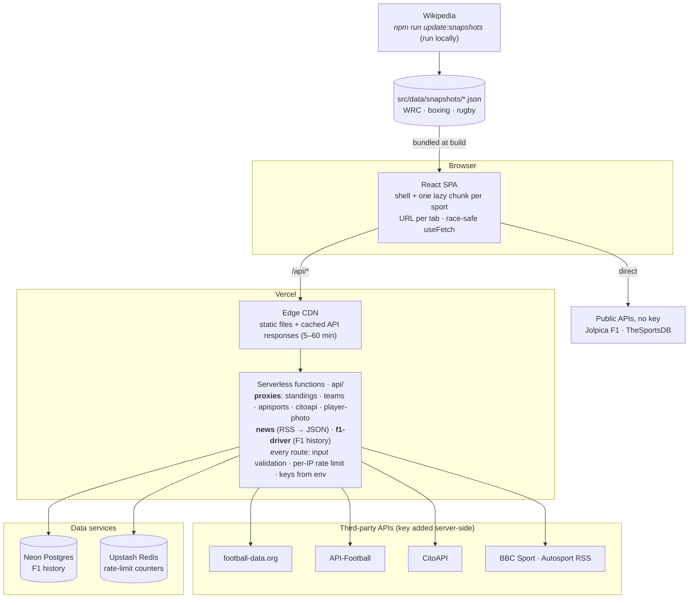

# Architecture

APEX is a single-page React app served by Vercel, backed by a small set of Vercel serverless functions. The functions exist for two reasons: to keep API keys off the browser, and to cache and rate-limit calls to free-tier upstream APIs. There are no user accounts.

## System diagram



Three kinds of data reach the page:

| Kind | Examples | Path | Freshness |
|---|---|---|---|
| **Live via proxy** | football tables, squads, UFC, news | browser → `/api/*` → upstream (key added server-side) | CDN-cached 5–60 min |
| **Live direct** | F1 standings/results/calendar (Jolpica), UFC fallback (TheSportsDB) | browser → public API (no key) | per request |
| **Snapshot** | WRC season, boxing champions, rugby tables | Wikipedia → update script → JSON in repo → bundled | as of the date shown on the page |

## How a page load works

1. **Shell.** Vercel serves `index.html` for any non-API path (`vercel.json` rewrite). The main bundle contains React, the router, the header/tabs, `SportsRecents` and shared helpers (77 KB gzipped).
2. **Route → tab.** The URL is the single source of truth: `/football`, `/f1`, `/mma`, `/boxing`, `/rugby`, `/wrc`, `/about` (`tabFromLocation` in `src/App.jsx`); any other path shows Football. Reloading or sharing a link keeps the tab.
3. **Intro.** The ~1.1 s logo animation plays once per browser session (`sessionStorage["apex:intro-seen"]`) and is skipped for `prefers-reduced-motion`.
4. **Sport chunk.** The tab's view is loaded with `React.lazy` (5–50 KB each) the first time it is opened.
5. **Data.** Each view fetches what it needs (see flows below). Panels show a loading state, then data, or an error with a retry; snapshot sections show "Updated <date> · Source", which turns into a warning after 60 days.

## Request flows

**Football league table (live, keyed).**
`FootballView` → `fetchStandings("PL")` (5-minute in-memory cache shared by the leader cards and the table) → `GET /api/standings?comp=PL` → function checks the competition allow-list and rate limit, adds `X-Auth-Token` → football-data.org → response cached at the CDN for 10 min (+1 h stale-while-revalidate). On HTTP 429 the client retries once after 7 s. If the live table fails, the table falls back to last season's bundled table with a clear badge; the leader cards say "Live table unavailable" and never use the fallback.

**Squad with player photos.**
Team list from football-data.org (`/api/teams`, current season) → club matched to its API-Football id by search (`src/api/teamMatch.js`: cleaned names, country filter, no youth/women/reserve sides, confidence threshold; result cached in `localStorage`) → `/api/apisports?endpoint=players/squads` → photos through `/api/player-photo` (host pinned to `media.api-sports.io`). No confident match → football-data.org squad without photos.

**Sports Recents (news).**
`SportsRecents` → `GET /api/news?sport=f1` → function fetches the sport's RSS feed, parses it without dependencies (`api/_newsParser.js`), keeps the 6 newest items with safe http(s) links only → CDN-cached 15 min. Lead story with image + 5 headlines; compact on phones.

## Frontend structure

```
src/
  App.jsx               shell: header, tabs, routing, footer, lazy views
  views/                one component per tab (+ AboutView)
  components/           SportsRecents, UpdatedNote, Avatar, Countdown, modals, status states
  hooks/                useFetch (race-safe fetching), useCountdown
  api/                  browser-side clients for the /api routes (teams, index) + teamMatch
  data/                 static data; snapshots/*.json are generated by the update script
  lib/timeAgo.js        relative timestamps
api/                    Vercel serverless functions; files starting with _ are shared modules, not routes
scripts/                update-snapshots.mjs (+ snapshots/ parsers), legacy F1 import scripts
tests/                  unit/ and feature/ Vitest suites
```

Styling uses CSS Modules plus design tokens in `src/index.css`: colours (including `--text-faint`, the lowest text tier that still passes WCAG AA), a 7-step type scale (`--fs-2xs` … `--fs-2xl`) and `--container`, which grow on screens ≥1600 px and ≥2200 px.

## Caching layers

| Layer | What | Lifetime |
|---|---|---|
| Vercel CDN | `/api/news` 15 min · `/api/standings` 10 min · `/api/teams` 60 min · `/api/apisports`, `/api/citoapi` 5 min · `/api/f1-driver` 60 min (all with stale-while-revalidate) | per URL |
| Browser memory | league tables (5 min) | per page session |
| `localStorage` | football-data → API-Football club ids | permanent (ids don't change) |
| `sessionStorage` | intro seen | browser session |
| Build | snapshot JSON | until the next update + deploy |

Errors are never cached (`Cache-Control: no-store` on failures).

## Data sources and licences

| Data | Source | Notes |
|---|---|---|
| F1 | [Jolpica F1](https://github.com/jolpica/jolpica-f1) | Ergast-compatible, no key |
| F1 history (driver profiles) | Neon Postgres, imported by `scripts/import-f1*.py` | ~79k result rows |
| Football | [football-data.org](https://www.football-data.org) free plan | 10 requests/min, current season |
| Squads & photos | [API-Football](https://www.api-football.com) free plan | 100 requests/day, seasons 2022–2024 only (squads are season-less) |
| UFC | CitoAPI, TheSportsDB | |
| News | BBC Sport, Autosport RSS | headlines link to the publisher |
| WRC, boxing, rugby | Wikipedia, **CC BY-SA 4.0** | snapshots, credited on the page and on `/about` |
| World Cup photos | Wikimedia Commons | licence per file in `src/data/worldcup/*.json` |

Driver and fighter avatars are generated initials, not photos, to avoid licensing problems.
